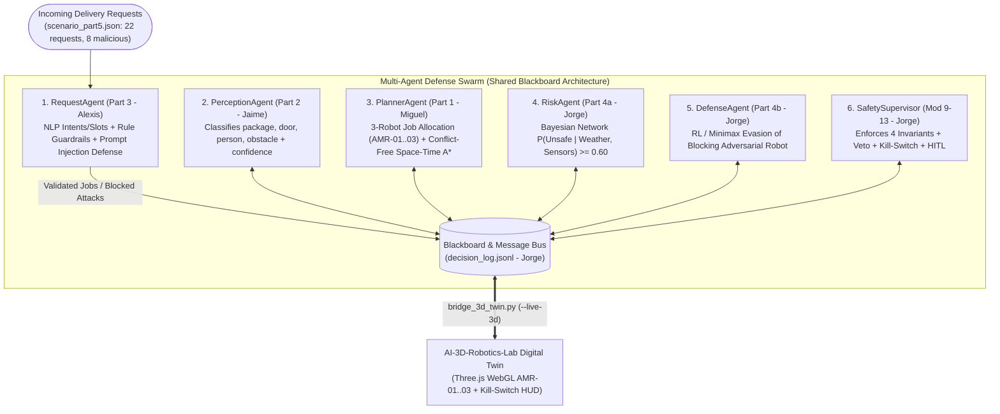

# 🤖 MDC Autonomous Multi-Agent Defense Swarm (Final Project — Part 5)

**Course:** CAI 4505C · Artificial Intelligence · Miami Dade College  
**Integration:** Parts 1–4 + Modules 9–13 Safety Supervisor + [AI-3D-Robotics-Lab](https://github.com/AI4666/AI-3D-Robotics-Lab) 3D Fleet Digital Twin  

---

## 👥 Team Roles ("One Part Per Member" Architecture Plan)

| Team Member | Role & Course Part Ownership | Primary Code Files Owned | Automated Tests Owned (`pytest`) | Scenario & Report Ownership |
| :--- | :--- | :--- | :--- | :--- |
| **Jorge A. Mendoza** *(Team Lead)* | **Lead Architect, Safety Supervisor, Part 4 & 3D Twin Lead** | `run_part5.py`, `swarm/blackboard.py`, `swarm/simulator.py`, `swarm/bridge_3d_twin.py`, `swarm/agents/safety_supervisor.py`, `swarm/agents/risk_agent.py`, `swarm/agents/defense_agent.py` | `tests/test_invariants.py` *(5 tests: 4 safety invariants + Part 4 Bayes/Minimax)* | **Adversary Scenario**, Architecture, Safety Invariants & Live 3D Kill-Switch Demo |
| **Miguel Martinez** | **Part 1 Owner** *(Space-Time A* Search & Multi-Robot CSP Scheduling)* | `swarm/agents/planner_agent.py`, `data/campus_map_medium.csv` | `tests/test_part1_planner.py` *(2 tests: 3-robot allocation & dynamic replan)* | **Normal Scenario & Ablation (1 vs. 3 Robots)**, Part 1 Integration |
| **Jaime Florez** | **Part 2 Owner** *(Computer Vision Object Classifier & Sensor Confidence)* | `swarm/agents/perception_agent.py`, `data/vision_labels.csv` | `tests/test_part2_perception.py` *(2 tests: 4-class vision & rain sensor drop)* | **Rain Scenario**, Part 2 Integration |
| **Alexis Zisopulos** | **Part 3 Owner** *(NLP Intents, Slot Parsing, Logic Rules & Cyber-Defense)* | `swarm/agents/request_agent.py`, `scenario_part5.json`, `data/rule_catalog.csv` | `tests/test_part3_request.py` *(2 tests: prompt injection & off-hours blocking)* | **Attack Scenario**, Part 3 Integration & Responsible AI Risk Register (R6) |

---

## 🏗️ System Architecture Diagram



---

## 📂 Repository Directory Structure

```text
mdc-autonomous-defense-swarm/
├── run_part5.py                     # R5: One-command CLI (python run_part5.py --scenario all)
├── scenario_part5.json              # R4: 22 delivery requests (14 valid, 8 malicious/invalid)
├── decision_log.jsonl               # R2: Full message & decision audit log
├── requirements.txt                 # Python dependencies (numpy, pytest, requests)
├── README.md                        # R5: Setup steps, architecture diagram, demo guide
│
├── data/
│   ├── campus_map_medium.csv        # From Part 1 (18x18 campus grid map)
│   ├── vision_labels.csv            # From Part 2 (object classification dataset)
│   ├── rule_catalog.csv             # From Part 3 (logical rules catalog)
│   └── sensor_readings.csv          # From Part 4 (rain/noisy sensor conditions)
│
├── swarm/                           # Core Python Multi-Agent Package (R1–R3)
│   ├── __init__.py
│   ├── blackboard.py                # R2: Shared state object & JSONL message bus
│   ├── simulator.py                 # R4: Scenario runner, metric collector & ablation engine
│   ├── bridge_3d_twin.py            # Streams live swarm state to digital_twin_app (WebSocket/HTTP)
│   │
│   └── agents/                      # R1: 6 Modular Agents
│       ├── __init__.py
│       ├── base_agent.py            # Standard input/output contract for all agents
│       ├── planner_agent.py         # [MIGUEL - Part 1] Job allocation (3+ AMRs) + conflict-free A*/CSP
│       ├── perception_agent.py      # [JAIME  - Part 2] Object classifier (package, door, person, obstacle)
│       ├── request_agent.py         # [ALEXIS - Part 3] NLP intent/slot parser + prompt-injection blocker
│       ├── risk_agent.py            # [JORGE  - Part 4] Bayesian Network route risk + threshold filter
│       ├── defense_agent.py         # [JORGE  - Part 4] RL / Minimax evasion against adversarial robot
│       └── safety_supervisor.py     # [JORGE  - Lead]   4+ invariants, action veto, kill-switch, HITL
│
├── tests/                           # R5: Automated pytest suite (11 tests total)
│   ├── test_part1_planner.py        # [MIGUEL] 2 tests: 3-robot routing & obstacle replanning
│   ├── test_part2_perception.py     # [JAIME]  2 tests: 4-class object classification & rain confidence
│   ├── test_part3_request.py        # [ALEXIS] 2 tests: prompt injection & restricted building blocked
│   └── test_invariants.py           # [JORGE]  5 tests: 4 Safety Supervisor invariants + Part 4 Bayes/Minimax
│
└── docs/                            # Deliverables & Evaluation Output
    └── evaluation_results.json      # Auto-generated scenario & ablation metrics
```

---

## 🚀 Setup & How to Run the Demo

### 1. Install Dependencies
```bash
pip install -r requirements.txt
```

### 2. Run All 4 Scenarios + Ablation Study (One-Command Requirement R5)
```bash
python run_part5.py --scenario all
```

### 3. Run the Automated Pytest Suite (11 Tests Including All 4 Safety Invariants)
```bash
pytest -v
```

### 4. Run Live with the 3D WebGL Digital Twin (`AI-3D-Robotics-Lab`)
If the Node.js 3D Digital Twin server (`digital_twin_app/server.js`) is running on `http://localhost:3000`, stream the live swarm execution in 3D:
```bash
python run_part5.py --scenario attack --live-3d
```

---

## 🛡️ Safety Invariants & Responsible AI (Requirements R3 & R6)

1. **`INV_1_NO_RESTRICTED_ZONE`**: Never enter or deliver to a restricted building (`server_room`, `restricted_vault`, `hazmat_storage`).
2. **`INV_2_NO_CELL_COLLISION`**: Never allow two robots to occupy the same `(r, c)` cell at the same timestep `t`.
3. **`INV_3_NO_UNVALIDATED_JOB`**: Never act on a request that failed `RequestAgent` rule validation or prompt-injection screening.
4. **`INV_4_KILL_SWITCH_AND_RISK`**: Immediately halt all robots when `kill_switch == True`, and veto/reroute paths whose Bayesian posterior risk exceeds $\tau = 0.60$.
